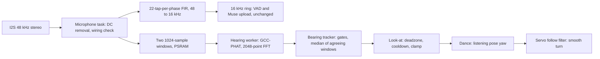

# Sound direction: turning toward a voice

While Bunty is listening, its head turns toward the sound. Two INMP441
microphones are sampled together at 48 kHz; the arrival-time difference between
them, found with GCC-PHAT, gives the angle; the pan servo follows it.

## How the angle is found

* **TDOA.** For a window `a` (left) and `b` (right), the cross spectrum
  `A * conj(B)` is divided by its own magnitude (the phase transform), limited
  to 300-5000 Hz, and inverse transformed. The peak's position is the delay of
  `b` behind `a`, in samples; a parabola through the peak and its neighbours
  gives it to a fraction of a sample. PHAT keeps the peak sharp in a reflective
  room, where plain correlation smears across echoes.
* **Zero padding.** 1024-sample windows are padded to 2048, so no circular
  wrap can alias into the +/-9 sample range that matters.
* **Two FFTs per window.** Left rides in the real part and right in the
  imaginary part of one complex FFT; the inverse reuses the forward routine.
* **Angle.** `theta = asin(c * tau / d)`: speed of sound, delay, and spacing.
  At 60 mm and 48 kHz the delay spans +/-8.4 samples, so one sample of lag is
  about 7 degrees near the front and a quarter-sample interpolation gives
  about 2. At the old 16 kHz it spanned +/-2.8, hence 48 kHz.
* **Confidence.** The correlation peak divided by its ceiling (1 for a perfect
  delayed copy, about 0.05 for noise). Windows below 0.12, quiet windows,
  windows where one capsule is more than 4x louder than the other, and lags
  beyond the physical limit are discarded.
* **Stability.** A bearing is published only when at least 3 of the last 5
  windows agree within 15 degrees; the published value is their mean. The head
  moves only when the new bearing is 10+ degrees from where it looks and 800 ms
  have passed since the last move.

## What changed in the audio path

`Microphone` now reads 10 ms (480 frames) at 48 kHz. Per frame it does the same
DC removal, wiring check and slot mixing as before, then a low-pass FIR
(flat to 6.5 kHz, more than 40 dB down by 9.5 kHz, so nothing folds into the
speech band) feeds every third sample into the existing 16 kHz ring. VAD, the
pre-roll, the utterance buffer and the Muse upload see the same 16 kHz mono as
before. The raw per-channel samples are copied to the hearing worker only when
both capsules are working and the head is still.

Set `cfg::audio::kMicSampleRate` to 16000 to bypass the filter and run the old
capture, or `cfg::hearing::kEnabled` to false to keep 48 kHz capture without
direction finding.

| Cost | Amount |
| --- | --- |
| Internal RAM, I2S DMA | +3.8 KB (6 x 240 frames x 8 B = 11.5 KB, was 7.7 KB) |
| Internal RAM, static | +2.9 KB (read buffers) and about 1.1 KB for the filter state in the `Microphone` object |
| PSRAM | about 36 KB (windows 8 KB, FFT work 16 KB, twiddles 8 KB, Hann 4 KB) |
| CPU, mic task | about 3 to 4 million operations per second for the filter and checks |
| CPU, worker | one window in the order of 10 ms on an S3, at most about 10 per second, priority 3 |

The mic is only processed while a conversation is listening, as before.

## Moving the head

Bearings steer only the **listening pose**: `Dance` aims yaw at the look-at
target at 40 degrees per second through the servo's follow filter, which is a
first-order smoother with a rate cap, so the turn glides. Leaving the listening
phase returns the head to centre, as the other phases already do.

The turn is limited to +/-18 degrees (`cfg::dance::kMaxYawDegrees`). That is not
a signal limit but the power budget: listening already holds the 440 mA dance
reservation, and a full-travel servo needs 750 mA, which does not fit beside it
(`Config.h` static assertions). A larger sweep means giving the turn its own
claim, as the removed `serviceLookAtSpeaker` did, and is a separate change.

Windows are discarded while either servo is moving and for 250 ms after, because
the motor's whine and the board's shake would otherwise correlate in both
capsules and read as a source dead ahead.

## Limits to know about

* **Front and back mirror.** Two microphones cannot tell them apart.
* **Single dominant source.** Two talkers or a loud fan produce a low, flat
  peak and are rejected, not averaged.
* **Own voice and speaker.** Capture is off while Bunty speaks, so it cannot
  turn toward itself.
* **Spacing.** Every angle scales with `cfg::mic::kSpacingMm`. Measure it
  centre to centre. A wrong value compresses or stretches all bearings.
* **L/R wiring.** One INMP441 must have L/R tied to ground and the other to
  3.3 V, or they share a slot. The existing wiring check reports this on boot.

## Bring-up on hardware (not yet done)

None of this has been built with ESP-IDF or run on a device; the signal
processing has only been checked against synthetic delayed signals on a desktop.

1. Build and flash. Boot logs should show
   `[hearing] 60 mm spacing gives +/-8.4 samples at 48000 Hz` and
   `[mic] left slot ok, right slot ok`.
2. Check voice first: tap to talk and confirm the VAD triggers and Muse
   understands you, since the 16 kHz path is now fed by the filter.
3. Stand to Bunty's **left** and speak. The log should print a **negative**
   `source`. If it is positive, set `cfg::mic::kSwapChannels = true`.
4. Confirm the head turns **toward** you. If it turns away, set
   `cfg::hearing::kServoSign = -1.0f`.
5. Measure spacing and correct it if the angle at the side reads well short of
   +/-90 degrees.
6. If the microphones turn with the head, set `cfg::hearing::kMicsOnHead = true`
   so each correction is added to the current pose.
7. Watch `[memory]` reports for internal free heap against the Wi-Fi and TLS
   headroom; the extra 8 KB of internal RAM (DMA plus buffers) is the part most worth measuring.

Tuning knobs, all in `Config.h` under `hearing`: `kMinimumRms`,
`kMinimumCoherence`, `kDeadzoneDegrees`, `kTurnCooldownMs`,
`kLookDegreesPerSecond`.

## Verification so far

`tests/host/hearing_test.cpp` (in `tests/host/run.sh`) checks, under UBSan: the
FFT against a direct DFT; delay recovery from -8 to +8 samples to better than
0.01 sample with clean signals and to 0.6 sample with 12 dB SNR plus echoes;
noise and silence are not bearings; bearing sign, mirroring, the channel swap,
the quiet, dead-capsule, incoherent and out-of-range gates, and outvoting a
single outlier; the look-at deadzone, cooldown, clamp and head-mounted feedback;
the decimator's pass band (within 0.5 dB to 6 kHz) and stop band (more than
40 dB down from 10 to 20 kHz).

The real `Hearing.cpp` worker was also exercised on a desktop with a threaded
FreeRTOS stub: a left source reported -30 degrees and a right one +30, `hold()`,
`reset()`, gaps and stale results behaved. The `AudioIo.cpp` changes and
`main.cpp` wiring could not be compiled here and need a build.
