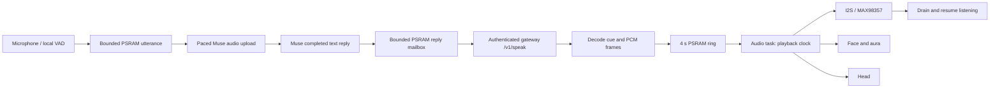

# Muse voice reply flow and listening UI

[Conversation preview](docs/bunty-listening-preview.png) shows listening,
thinking and speaking using the real renderer. The conversation screen contains
only the face and border aura: no waveform, wordmark, phase title, captions or
close/End/Send controls. Pause for 900 ms to send automatically. Listening stays
active through silence and screen changes until a long press ends it or a
connection/playback failure occurs. Tapping the face during a reply interrupts
and resumes listening; taps during listening do not end/send it.

The border colour eases over 320 ms. Eyes and blink timing persist across
transitions, and the mouth smoothly closes between replies. Thinking begins as
soon as capture ends, before the buffered upload starts. Face redraws allocate
no buffers or heap storage; remote text, image and calendar views remain available.

[Aura preview](docs/bunty-aura-preview.png) uses the real display renderer.
A three-pixel edge aura remains visible on faces, images, calendars and other
screens: mint while listening, lavender while thinking, ivory while speaking.
Listening gently breathes and reacts to microphone levels; speaking reacts to
output levels. Opening Talk during a conversation returns to its face while
preserving the active session. The microphone still pauses during reply processing
and playback to prevent Bunty from recording its own speaker.

The aura is composed into the existing DMA transfer buffer, preserving the
underlying image pixels. Its refresh touches only 3,324 edge pixels in four SPI
submissions, at most ten updates per second, and adds no framebuffer or drawing
allocations. Clearing it restores the original content. Failed transfers retry.

## Request to playback

## One clock for sound, face and head

Audio position is the only clock during speech. Muse tags each sentence, for
example `[happy] [nod] Sure. [sad] It's gone.`, and the gateway splits the reply
at those tags, strips them and anything unspeakable, and returns PCM with a cue
frame placed at the exact byte each sentence starts. The device fires a cue when
playback reaches that sample, so an expression can't drift from its words however
the network behaves. Muse needs no tool call, which also removes one model round
trip per reply. Untagged sentences fall back to their punctuation, then to the
previous expression.

`POST /v1/speak` frames are one type byte, a 24-bit little-endian length and the
payload: 1 audio (16 kHz mono PCM, may split a sample), 2 cue (ASCII
`emotion,gesture`), 3 end (u32 audio byte count), 4 picture (a GIF for the next
cue). Unknown types are skipped. The
gateway synthesizes one sentence ahead, so the next is ready as this one ends. A
failure on the first sentence is an HTTP error; a later one ends the stream early
and what already arrived still plays.

The fetch task decodes into a 4 s PSRAM ring and a separate `muse_audio` task
feeds I2S. Before this, TLS reads drove the speaker directly over 60 ms of DMA, so
any stall was an audible gap and the mouth followed the network. Playback starts
at 300 ms buffered, or when the stream ends; an underrun holds the amplifier on
and resumes at 100 ms. Cues and loudness are published as samples enter the I2S
queue, about 60 ms before they sound, which covers display frame time and servo
lag. A tap silences within one 20 ms block rather than waiting for the network.

| Task state | Sound | Face and aura | Head |
| --- | --- | --- | --- |
| Listening | Silent | Wide eyes, mint aura following the mic | Cocked, attentive |
| Heard you | Soft two-note chime, local and instant | Lids lower, lavender aura | Glances aside |
| Thinking | Silent | Gaze aside, slow breath | Held glance |
| Working (Muse reports busy) | Silent | Gaze scans, quicker pulse | Slow scan |
| Speaking | Reply | Emotion per sentence, mouth on loudness, ivory aura; a [reaction picture](GIF.md#reaction-pictures) where the reply calls for one | Style per sentence, lifts with the voice, settles in pauses |

Muse is told to announce a slow task in one short sentence, then deliver the
result as a second message. The SDK's link path ended a turn 3 s after any reply,
so that result was lost. It now holds a turn while Muse reports `agent.status` or
`task.status` as busy (60 s bound), ends 800 ms after a busy agent goes idle, and
keeps the plain 3 s settle otherwise. An idle status before any busy one is the
state at subscribe, not a finish. Bunty stays in its speaking pose between queued
messages. Trailing VAD silence beyond 250 ms is no longer uploaded.

The microphone records into a checked 1 MiB PSRAM utterance buffer, covering
the 30-second VAD limit and 320 ms pre-roll. It opens no Muse request during
capture. Once VAD ends the utterance, capture pauses and the complete recording
is uploaded in order. Capture does not wait on transport backpressure or lose
samples because a send operation blocks. The recording is reset after send,
cancellation or failure; silence opens no request.

Bunty's SDK staging emits 8 KiB base64 body chunks (6 KiB PCM), reducing the
number of Noise/TLS sends fourfold. Staging/base64 buffers and queued body copies
are explicitly allocated in PSRAM. The queue retains six slots and its 16 KiB
byte bound; those PSRAM bytes are not falsely counted as reclaimable DMA memory.
Each body admission waits up to five seconds. The upload checks cancellation,
connection and a 60-second total deadline between operations; a blocking enqueue
may return up to five seconds after the total deadline. Queue failures stop the
upload immediately. Logs distinguish a byte-budget stall from full slots using
only counts and DMA heap levels. No request is automatically resent.

The microphone pauses while uploading, waiting for the reply and throughout playback.
Only the voice task polls Muse; only the TTS worker owns HTTP/speaker cleanup.
The mailbox retains each job until cleanup finishes, including cancellation.

Reply subscription admission previously used a zero-wait send to the same
six-slot queue as the microphone chunks. A healthy but temporarily full queue
could reject the subscription at the end of an utterance. Bunty allows up to one second to admit a request-open; body admissions use the
five-second upload bound described above. The queue is not enlarged and
ambiguous requests are not resent. Capture is now separate from upload. Queue stalls and subscription failures have specific
visible errors; note ACK logs contain only HTTP status, byte count and overflow.
A production request-open test simulates a full queue that drains after 300 ms,
a wait exceeding the one-second bound, and disconnected admission.

The SDK previously checked subscription errors before draining completed replies.
A disconnect could discard a valid reply already queued, including one received
before the upload acknowledgment. The adapter now waits for acknowledgment to
correlate pending replies, drains valid replies first, and treats subscription
closure after a completed reply as turn completion. Authorization/server errors,
uncorrelated responses and disconnects with no complete reply remain failures.
Reply waiting has a three-minute ceiling, including app approval and tool work.
Transient reply-stream failures (disconnect/closed stream, HTTP 409/429/5xx)
recover with exponential backoff (0.5, 1, 2, 4, 8, 16 seconds, then a 30-second
cap), until the same three-minute total deadline. This permits at most ten
recovery attempts in that window rather than aborting after three quick retries. The
recording is never uploaded again during recovery, and existing parent IDs,
sequence deduplication and callback generations are preserved. HTTP 401/403
and other non-transient 4xx responses remain failures. Successful recovery is
covered by the actual SDK harness, including a delayed reply after 61 seconds,
late recovery beyond three retries, failed reopen/send recovery, deadline expiry,
bounded attempt counts and proof that the original upload request is unchanged.
This does not prove recovery of the user's app permission flow without serial
logs from that occurrence.
Visible errors now distinguish timeout, connection interruption, rejected upload,
reply access and memory/size limits without exposing remote diagnostic text.

The previous worker silently dropped failed TTS jobs and resumed listening once
the queue emptied. That meant a failed spoken reply could look like a completed
conversation. A local playback failure is logged and does not cancel the accepted Muse turn,
its reply subscription or pending image/tool work. New replies can still be
spoken and a successful completion resumes listening, clearing the old speech
error. A terminal Muse failure or an explicit end still cancels queued speech.
Speech failures retain a specific diagnostic (authorization, response timeout, format,
empty/incomplete stream, speaker initialization/write failure, or power busy).
The Speaking phase starts only after real PCM samples reach I2S, not when the
speaker opens on silence.

TTS now waits up to 15 seconds per blocking connection/request/header operation,
then reduces individual audio reads to three seconds. Cancellation checks run
between blocking calls; they cannot abort an in-progress TLS call immediately,
though the speaker itself stops at once. Power admission retries for up to two
seconds. A reply is bounded at 90 seconds / 2,880,000 bytes. Failed
requests are not automatically retried, avoiding duplicate or repeated partial
speech. A new conversation clears the previous visible error.

Relevant response headers are captured directly from HTTP header events into
fixed bounded storage. The SDK saves only ten headers by default, so its cache
is not used to decide audio format. The firmware accepts explicit mono 16 kHz
`application/vnd.bunty.speech` with `X-Audio-Byte-Order: little-endian`, allowing
case, spacing, parameter order and quoted values. Conflicting/oversized headers, other sample
rates, stereo, JSON or MP3 are rejected. One-byte reads are carried into the
next chunk; negative samples preserve their signed little-endian representation.
An empty response or odd/truncated end is an error.

## Verification and remaining limit

Bunty shows no words in conversation. Failures appear as a sad face and a shake
of the head, with the reason in the serial log, and `cfg::ui::kTextContent` keeps
every text-drawing Muse tool unregistered and rejected. Pairing, Settings and
boot failures still use text, because nothing else can express them.

The synchronized speech path (2026-11-01) passes the host suite, the SDK harness
and the gateway suite, and the real Worker's output was decoded by the real player
sample-exact at 1, 7 and 1,280-byte reads, including every reaction picture through
the actual GIF validator, decoder and zoom. It has **not** been built with ESP-IDF
or run on a device. Timing, chime loudness, motion and the live `agent.status`
behaviour need a physical turn. Deploy the gateway first: this firmware speaks
only through `/v1/speak`. `/v1/tts` remains for older firmware. Tags also appear
in the Muse app's text of the conversation.

The configured gateway credential successfully synthesized both short and
realistic-length test replies from this Mac with the ESP-IDF user agent. The
responses were HTTP 200, mono 16 kHz PCM, little endian. This verifies the gateway
and configured credential; it does not verify the token stored on the device or
physical playback. No device credentials or reply content were logged.

The host suite exercises the actual production playback pipeline with scripted
transport/speaker operations: partial request writes, odd PCM chunk boundaries,
late headers beyond ten unrelated headers, an eight-second synthesis wait,
power retry, authorization/rate errors, speaker/read/write failures, empty and
truncated responses, drain, cancellation and clock wrapping. SDK Python checks
also assert a correlated, deduplicated Muse reply invokes the Bunty TTS callback
exactly once with its text, and cover disconnects before/after acknowledgment. The full host suite, seven Python checks and ESP-IDF
build pass. Individual voice loop/playback frames remain 912/544 bytes, excluding
callees; scratch audio and request body remain in PSRAM.

The silent-failure handling and response validation defects are corrected in
code. The reported hardware symptom has not been reproduced or confirmed fixed:
The updated queue handling and gadget UI were flashed on 6 October 2026.
The device reconnected during diagnostics, but no voice attempt was captured;
physical speech playback and resolution of the reported failure remain pending.
The later upload-queue stall report prompted the buffered upload change above;
that build was also flashed with its firmware hash verified. Live spoken-turn
verification is pending.

For live verification, flash without erasing NVS, then tap Talk and speak a short
question. Stage logs should progress through speech detected, utterance ended,
utterance acknowledged, transcription received, reply received, TTS HTTP 200,
playback started and successful completion, then return to listening. Logs use
stage/count metadata rather than spoken text or credentials. Any missing stage
identifies the next device-side diagnostic. Test long press during thinking/playback and
several consecutive replies, alongside speaker initialization and PCM checks.

The face-only conversation update passed host/SDK checks, built and flashed.
Startup verification confirmed Muse registration without an observed panic.
Physical face transitions and a complete voice turn still need verification.

The reply recovery and GIF palette fixes passed host/SDK checks and were built.
The fixes were subsequently flashed successfully, with the flash checksum verified.

The 2026-10-06 follow-up removes the short three-attempt recovery cap and the
fatal TTS-to-Muse cancellation coupling. SDK regression checks cover recovery
after a fourth failure, no duplicate voice uploads, HTTP authorization failures,
capped pacing and three-minute expiry even when reopening fails. A 120-second
serial capture again recorded registration but no voice attempt; the reported
app permission/error sequence is not yet reproduced on hardware.
The waiting/speech coupling fixes were built and flashed with checksum
verification on 2026-10-06. App-side hosting permissions remain app-controlled.
